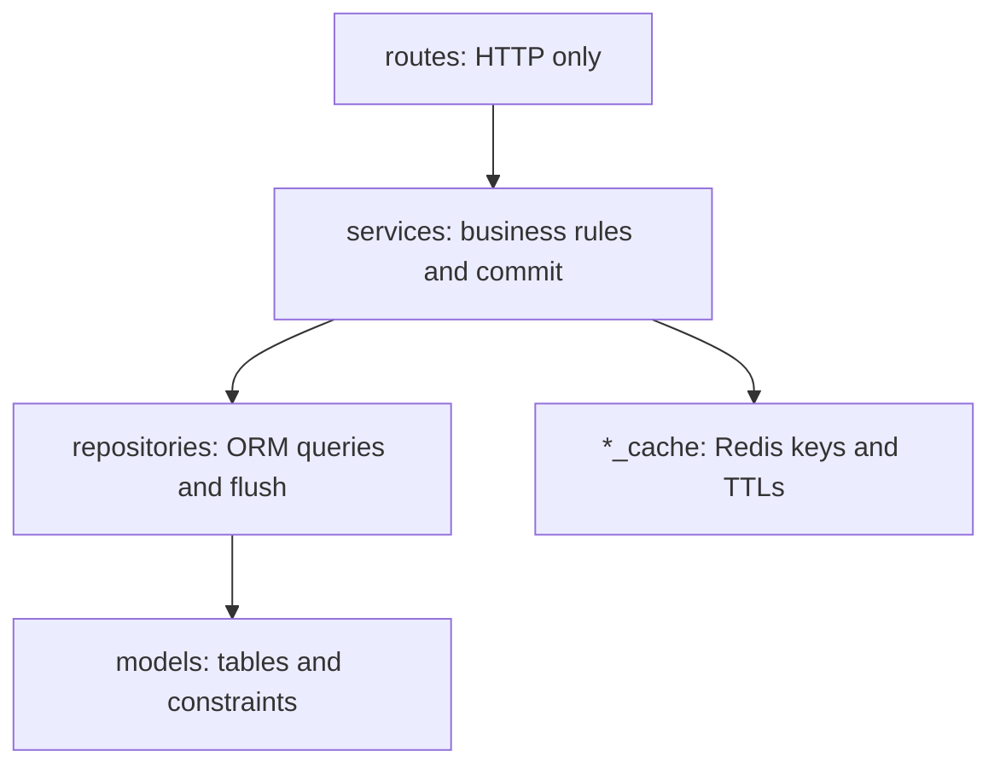

# Architecture

A Flask API with PostgreSQL as the source of truth and Redis as an optional cache. If Redis is down the API keeps working, just slower.

## Layers



| Folder | Does | Doesn't |
|---|---|---|
| `app/routes/` | Parse the request, call a service, build the response. | Hold business rules or queries. |
| `app/schemas/` | Validate input and shape output with Pydantic. | Touch the database. |
| `app/services/` | Apply business rules, commit, invalidate the cache. | Know about HTTP. |
| `app/repositories/` | Run queries, flush, turn constraint errors into domain errors. | Commit. |
| `app/models/` | Define tables and constraints. | Hold business rules. |
| `app/security/` | Tokens, passwords, roles and permissions. | Know about Flask. |

`app/auth.py` is the bridge between Flask and `app/security/`.

## Conventions

Follow these in new modules. All of them are already in the code.

- Each route file has a small factory, like `_product_service()`, that builds the service with its dependencies.
- Repositories receive the session. They never call `get_session()`.
- Services commit. Repositories only flush. That way a whole operation is one transaction.
- Cache invalidation runs after the commit.
- Requests go through `parse(Schema, data)`. Responses go through `ok()`, `created()` or `no_content()`.
- Input schemas extend `InputSchema`, which rejects unknown fields. Read schemas extend `ReadSchema`.
- Business errors are `DomainError` subclasses. `app/errors/handlers.py` is the only place that maps them to HTTP.
- Each repository has a map from constraint name to domain error, like `CONSTRAINT_ERRORS` in `invoice_repository.py`.
- Money is `Decimal` and `Numeric(10, 2)`. Quantities are `Numeric(12, 3)`, since some products sell by weight. Never use `float`.

## How a request is checked

1. `login_required` or `permission_required` verifies the JWT and loads the user. Otherwise it returns 401.
2. If the token's `ver` doesn't match `user.token_version`, it also returns 401. This is how logout revokes tokens.
3. `permission_required` looks up the user's role in `ROLE_PERMISSIONS`. If the permission is missing, it returns 403.
4. The service checks ownership. Someone else's cart, invoice or user account returns 404, so the API doesn't reveal that it exists.

The role is read from the database on every request, not from the token, so role changes apply right away.

## Errors

Every error uses [RFC 9457 Problem Details](https://www.rfc-editor.org/rfc/rfc9457) with `Content-Type: application/problem+json`:

```json
{
  "type": "about:blank",
  "title": "Conflict",
  "status": 409,
  "detail": "Not enough stock.",
  "instance": "/api/v1/carts/3/checkout",
  "request_id": "b2ee4c60a884",
  "errors": { "products": [{ "product_id": 2, "requested": "2", "available": "1.000" }] }
}
```

`errors` appears only when there are details. Every response also carries `X-Request-ID`, and the same id is in the logs.

| Exception | Status | Example |
|---|---|---|
| `ValidationError` | 422 | Invalid fields, empty cart |
| `UnauthorizedError` | 401 | Missing or expired token, wrong password |
| `ForbiddenError` | 403 | A client calling an admin endpoint |
| `NotFoundError` | 404 | The resource doesn't exist or isn't yours |
| `ConflictError` | 409 | Duplicate email, not enough stock, cart already completed |

Flask adds 400 (invalid JSON), 405, 413 and 415. `OperationalError` becomes 503.

## Cart states

A cart has two states:

- **pending:** the cart is open. Its owner can add, change and remove items, check it out or delete it.
- **completed:** the cart was checked out and has an invoice. It can't change anymore.

| Action | From | To | If not allowed |
|---|---|---|---|
| `POST /carts` | (new) | pending | |
| Add, change or remove items | pending | pending | 409 if completed |
| `POST /carts/{id}/checkout` | pending | completed | 409 if completed or not enough stock, 422 if empty |
| `DELETE /carts/{id}` | pending | deleted | 409 if completed |

A failed checkout leaves the cart as `pending`, so the user can fix it and try again.

A user can have several pending carts and return to any of them with `GET /carts?status=pending`. Adding items doesn't reserve stock. Stock is checked only at checkout.

## Checkout

All of it runs in one transaction. If anything fails, the session closes without a commit and nothing is saved.

1. Lock the cart with `FOR UPDATE`.
2. Check that the user owns it, it's `pending` and it isn't empty.
3. Lock its products, ordered by id.
4. Check the stock.
5. Insert the invoice and its lines, with name and price snapshots.
6. Reduce the stock and mark the cart `completed`.
7. Commit.
8. Invalidate the products and invoices cache.
9. Return 201 with the invoice.


## Returns

Admin only, in one transaction:

1. Lock the invoice row. Return 404 if it doesn't exist and 409 if it's `returned`.
2. Check that each line belongs to this invoice. Otherwise return 422.
3. Add up what was already returned per line. Requested plus returned can't exceed purchased, otherwise return 409.
4. Lock the products by id and add the returned quantity to stock.
5. Insert the return and its lines. The refund is the sum of `line.price × quantity`.
6. Set the status to `returned` if every line is fully returned, otherwise `paid`.
7. Commit, then invalidate the invoice and its products.

## Cancelling a sale

There's no `DELETE /invoices/{number}`. An invoice is a financial record, so it's never deleted. To cancel a sale, an admin returns every line. That restores the stock and sets the invoice to `returned`. See [ADR-0005](adr/0005-invoice-snapshots-and-restricted-deletes.md).

## Configuration

Settings come from environment variables, loaded in `app/config.py`. See `.env.example`. `APP_ENV` picks `development`, `testing` or `production`. `create_app()` stops at startup if a required setting is missing.
