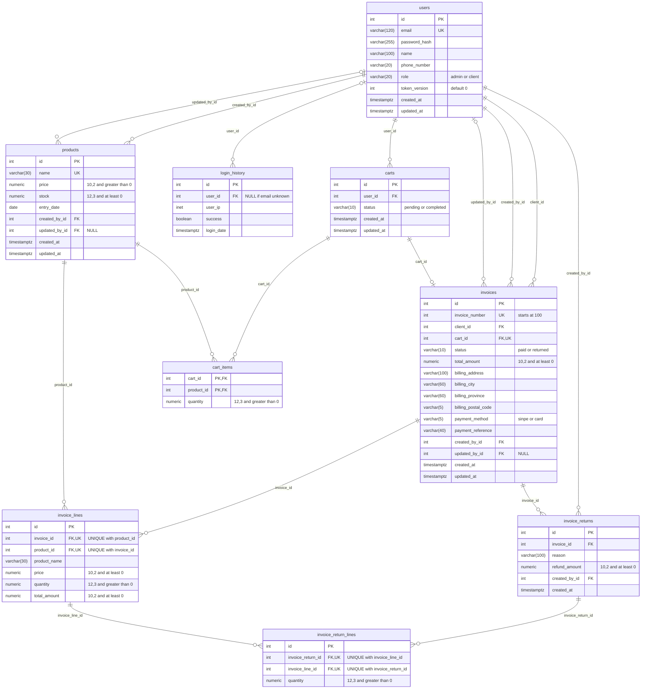

# Database

PostgreSQL through SQLAlchemy.

## **Tables**

## users 
|Name | Type | Details | Constraint | Index
|---|---|---|---|---|
| id PK                    | int            | | "pk_users" 
| email                 | varchar (120)    |  | "uq_users_email"
| password_hash            | varchar(255)        |                                
| name                     | varchar(100)   |                                
| phone_number             | varchar(20)    |                                
| role                     | varchar(20)        | "admin or client" | "ck_users_role_valid" 
| token_version default=0  | int            |                                
| created_at               | timestamptz    | server_default=func.now()      
| updated_at               | timestamptz    | server_default=func.now()

## login_history 
|Name | Type | Details | Constraint | Index 
|---|---|---|---|---|
| id | int | | "pk_login_history" 
| user_id | int | **NULL** if email unknown | "fk_login_history_user_id_users" | login_history.user_id
| user_ip | inet 
| success | boolean
| login_date |  timestamptz | server_default=func.now()

## products
|Name | Type | Details | Constraint | Index
|---|---|---|---|---|
| id | int | | "pk_products"
| name | varchar(30) | | "uq_products_name"
| price | numeric(10,2) | | "ck_products_price_positive"
| stock | numeric(12,3) | CheckConstraint("stock >= 0") | "ck_products_stock_non_negative"
| entry_date | date 
| created_by_id | int | | "fk_products_created_by_id_users" | products.created_by_id
| updated_by_id | int | **NULL** | "fk_products_updated_by_id_users" | products.updated_by_id
| created_at | timestamptz | server_default=func.now() 
| updated_at | timestamptz |  server_default=func.now()

## carts
|Name | Type | Details | Constraint| Index
|---|---|---|---|---|
| id | int | | "pk_carts"
| user_id |  int | | "fk_carts_user_id_users" | carts.user_id
| status | varchar(10) | "pending or completed" | "ck_carts_status_valid"
| created_at |  timestamptz | server_default=func.now()  
| updated_at | timestamptz | server_default=func.now() 

## cart_items
|Name | Type | Details | Constraint| Index
|---|---|---|---|---|
| cart_id | int | PK Composite with product_id | "pk_cart_items", "fk_cart_items_cart_id_carts" 
| product_id | int | PK Composite with cart_id | "pk_cart_items", "fk_cart_items_product_id_products" | cart_items.product_id
| quantity | numeric(12, 3) | quantity > 0 | "ck_cart_items_quantity_positive" 

## invoices
|Name | Type | Details | Constraint| Index
|---|---|---|---|---|
| id | int | | "pk_invoices"
| invoice_number | int  | "starts at 100" | "uq_invoices_invoice_number"
| client_id | int  | | "fk_invoices_client_id_users" | invoices.client_id
| cart_id | int | FK, UK | "fk_invoices_cart_id_carts", "uq_invoices_cart_id"
| status |  varchar(10) |  "paid or returned" | "ck_invoices_status_valid"
| total_amount | numeric(10,2) | total_amount >= 0 | "ck_invoices_total_amount_non_negative"
| billing_address | varchar(100) 
| billing_city | varchar(60)
| billing_province |  varchar(60)
| billing_postal_code | varchar(5) 
| payment_method | varchar(5) | "sinpe or card" | "ck_invoices_payment_method_valid"
| payment_reference |  varchar(40)
| created_by_id |  int | | "fk_invoices_created_by_id_users" | invoices.created_by_id
| updated_by_id | int | **NULL** | "fk_invoices_updated_by_id_users" | invoices.updated_by_id
| created_at |  timestamptz | server_default=func.now()
| updated_at |  timestamptz | server_default=func.now() 

## invoice_lines
|Name | Type | Details | Constraint| Index
|---|---|---|---|---|
| id | int | | "pk_invoice_lines"
| invoice_id | int | UNIQUE(invoice_id and product_id) | "fk_invoice_lines_invoice_id_invoices", "uq_invoice_lines_invoice_id"
| product_id | int | UNIQUE(invoice_id and product_id) | "fk_invoice_lines_product_id_products" | invoice_lines.product_id
| product_name |  varchar(30)
| price | numeric(10,2) | | "ck_invoice_lines_price_non_negative"
| quantity |  numeric(12,3) | quantity > 0 | "ck_invoice_lines_quantity_positive"
| total_amount |  numeric(10,2) | | "ck_invoice_lines_total_amount_non_negative"

## invoice_returns
|Name | Type | Details | Constraint| Index
|---|---|---|---|---|
| id |  int | | "pk_invoice_returns"
| invoice_id | int | | "fk_invoice_returns_invoice_id_invoices" | invoice_returns.invoice_id
| reason |  varchar(100) 
| refund_amount | numeric(10,2) | | "ck_invoice_returns_refund_amount_non_negative"
| created_by_id | int | | "fk_invoice_returns_created_by_id_users" | invoice_returns.created_by_id
| created_at | timestamptz | server_default=func.now() 

## invoice_return_lines
|Name | Type | Details | Constraint| Index
|---|---|---|---|---|
| id | int | | "pk_invoice_return_lines"
| invoice_return_id |  int | UNIQUE(invoice_return_id and invoice_line_id) | "fk_invoice_return_lines_invoice_return_id_invoice_returns", "uq_invoice_return_lines_invoice_return_id"
| invoice_line_id |  int | UNIQUE(invoice_return_id and invoice_line_id) | "fk_invoice_return_lines_invoice_line_id_invoice_lines" | invoice_return_lines.invoice_line_id
| quantity |  numeric(12,3) | quantity > 0 | "ck_invoice_return_lines_quantity_positive"

## Normalization

The schema is in third normal form (3NF), with a few copied or calculated values on purpose.

**1NF: one value per cell.** No column holds a list. A cart's products are rows in `cart_items`, not a list inside `carts`. The billing address is split into `billing_address`, `billing_city`, `billing_province` and `billing_postal_code`.

**2NF: no column depends on only part of a key.** Only `cart_items` has a composite key, and its one extra column, `quantity`, depends on both `cart_id` and `product_id`. Every other table has a single-column key, so it meets 2NF automatically.

**3NF: no column depends on another non-key column.** Each table only stores facts about its own key. `cart_items` stores `product_id`, not the product's name or price. `invoices` stores `client_id`, not the client's name or email.

### Copies and totals kept on purpose

| Column | Why it's stored |
|---|---|
| `invoice_lines.product_name`, `invoice_lines.price` | The product at the time of the sale. Reading them from `products` would change old invoices when a product is renamed or repriced. |
| Billing columns in `invoices` | The address used for that sale. A user's later address doesn't change past invoices. |
| `invoice_lines.total_amount`, `invoices.total_amount`, `invoice_returns.refund_amount` | Amounts of a financial record. They're calculated once, in the same transaction, and never updated, so they can't fall out of sync. |

These aren't duplicated data in the normalization sense. Each one records a fact at a point in time, while the source column holds the current value. See [ADR-0005](adr/0005-invoice-snapshots-and-restricted-deletes.md).

## Deletes

| `ondelete` | Foreign keys | Why |
|---|---|---|
| `CASCADE` | `carts.user_id`, `cart_items.cart_id`, `cart_items.product_id` | A cart or item means nothing without its owner, cart or product. |
| `SET NULL` | `login_history.user_id` | The audit log stays even if the user is deleted. |
| `RESTRICT` | Every other FK | Sales, returns and audit columns are history. Deleting their user or product returns 409. |

`USER_REFERENCING_CONSTRAINTS` in `user_repository.py` must list every `RESTRICT` FK to `users`. Deleting a user that one of them still references returns 409 instead of 500. Today they are `fk_products_created_by_id_users`, `fk_products_updated_by_id_users`, `fk_invoices_client_id_users`, `fk_invoices_created_by_id_users` and `fk_invoices_updated_by_id_users`. Add `fk_invoice_returns_created_by_id_users` when the `invoice_returns` table is implemented. `carts.user_id` (`CASCADE`) and `login_history.user_id` (`SET NULL`) never block a delete, so they don't belong in the list.

## Entity-relationship diagram

